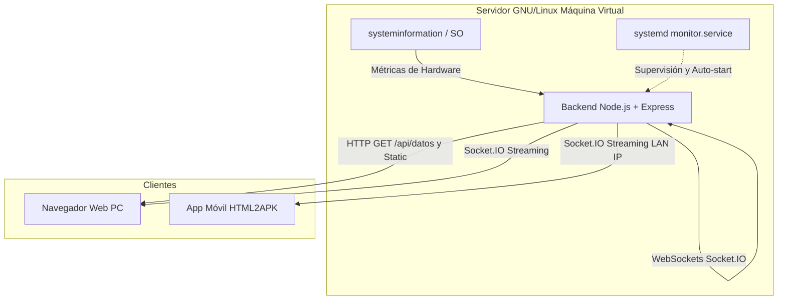

# Monitor de Recursos GNU/Linux

## Descripción

Aplicación cliente-servidor para el monitoreo de recursos de hardware en tiempo real sobre un servidor GNU/Linux.

El sistema recolecta métricas de hardware mediante la librería `systeminformation`, expone los datos a través de una API REST y un canal de WebSockets (Socket.IO), y los visualiza en un dashboard responsivo compatible tanto con navegadores web como con dispositivos móviles empaquetados mediante HTML2APK.

## Tecnologías utilizadas

### Backend
- Node.js
- Express
- Socket.IO
- systeminformation
- CORS
- pnpm / npm

### Frontend
- HTML5
- CSS3
- JavaScript (ES6)
- Bootstrap 5
- Chart.js

### Entorno y Despliegue
- GNU/Linux (VirtualBox / KVM / Servidor VPS)
- systemd (gestión de servicios automáticos del sistema)
- HTML2APK (compilación a entorno móvil)
- Git y GitHub (GitHub Projects / Kanban)

## Características

- Consulta de información base del servidor (SO, Kernel, procesador y núcleos) vía API REST.
- Streaming de métricas en tiempo real mediante WebSockets cada 1.5 segundos.
- Gráficos históricos dinámicos de uso de CPU y Memoria RAM.
- Indicadores de almacenamiento en disco, tiempo de encendido (uptime) y tráfico de red.
- Frontend desacoplado servido automáticamente por Express.
- Inicio automático como servicio en segundo plano con el arranque de GNU/Linux.
- Aplicación empaquetada como APK para Android.

## Arquitectura



## Estructura del proyecto

```text
monitor-server/
├── backend/
│   ├── server.js
│   └── package.json
├── frontend/
│   ├── index.html
│   └── app.js
├── mobile/
│   └── monitor-linux.apk
├── systemd/
│   └── monitor.service
├── .gitignore
└── README.md
```

## Archivos principales

| Archivo | Descripción |
|---|---|
| `backend/server.js` | Servidor Node.js con Express, endpoints REST y WebSockets con Socket.IO |
| `backend/package.json` | Declaración de dependencias y scripts de ejecución con pnpm |
| `frontend/index.html` | Estructura visual del dashboard diseñada con Bootstrap 5 |
| `frontend/app.js` | Conexión con la API REST, suscripción al WebSocket y renderizado de Chart.js |
| `systemd/monitor.service` | Archivo de unidad systemd para levantar la app con el boot de Linux |
| `mobile/monitor-linux.apk` | Compilación instalable en Android generada con HTML2APK |

## Flujo de Trabajo en Git

Para el desarrollo colaborativo se aplicaron las siguientes pautas:
- `main`: Rama principal de producción con el código funcional y probado.
- `feat/carolina`: Rama asignada a la integrante Carolina.
- `feat/martin`: Rama asignada al integrante Martin.
- Integraciones controladas mediante `merge` hacia la rama principal.
- Seguimiento de tareas y estados mediante **GitHub Projects (Kanban)**.

## Requisitos

Para desplegar y ejecutar el proyecto se necesita:
- Máquina Virtual con distribución GNU/Linux (Debian, Ubuntu Server o similar) con red configurada en modo Adaptador Puente (Bridge) o NAT con reenvío de puertos.
- Node.js v18+ y pnpm instalados en la máquina virtual.
- Permisos de superusuario (`sudo`) para configurar el servicio systemd.

## Instalación y Puesta en Marcha

### 1. Clonar el repositorio en la máquina virtual Linux

```bash
git clone https://github.com/CarolinaBadilla/TP-Final-PP3
cd TP-Final-PP3/backend
```

### 2. Instalar dependencias con pnpm

```bash
pnpm install
```

### 3. Ejecución en modo desarrollo / prueba

```bash
node server.js
```

La aplicación quedará disponible en el puerto `3000` de la IP del servidor.

## Configuración del Servicio systemd

Para que la aplicación funcione como un servicio del sistema operativo y arranque automáticamente al reiniciar la máquina virtual:

1. Copiar el archivo del servicio al directorio de systemd:
   ```bash
   sudo cp ../systemd/monitor.service /etc/systemd/system/monitor.service
   ```

2. Recargar los daemons del sistema:
   ```bash
   sudo systemctl daemon-reload
   ```

3. Habilitar el servicio para el inicio automático del sistema:
   ```bash
   sudo systemctl enable monitor.service
   ```

4. Iniciar el servicio:
   ```bash
   sudo systemctl start monitor.service
   ```

5. Comprobar el estado del servicio:
   ```bash
   sudo systemctl status monitor.service
   ```

## Funcionamiento del Flujo de Datos

```text
Hardware GNU/Linux (CPU, RAM, Disco, Red)
       ↓
systeminformation
       ↓
Servidor Node.js (Express + Socket.IO)
       ↓
       ├── [GET /api/datos] -> Carga datos estáticos del Host
       └── [Event: metricas] -> Emisión continua por WebSockets cada 1.5s
       ↓
Frontend (Bootstrap 5 + Chart.js)
       ├── Acceso vía Web (http://IP_SERVIDOR:3000)
       └── Acceso vía App Móvil (APK empaquetado)
```

## Capturas de pantalla


## Pruebas Realizadas

| Prueba | Resultado |
|---|---|
| Consulta HTTP al endpoint `/api/datos` | OK |
| Conexión bidireccional WebSockets con Socket.IO | OK |
| Renderizado dinámico de gráficos con Chart.js | OK |
| Despliegue estático del frontend desde Express | OK |
| Persistencia del servicio tras reiniciar la máquina virtual con `sudo reboot` | OK |
| Conexión remota desde la APK móvil apuntando a la IP de la VM | OK |

## Autores

- Martin Felix
- Carolina Badilla

## Conclusión

El proyecto integra de manera práctica la administración de servidores GNU/Linux, el desarrollo backend con Node.js orientado a eventos en tiempo real y la creación de interfaces web reactivas adaptables a plataformas móviles. La automatización mediante `systemd` garantiza alta disponibilidad del servicio ante reinicios del sistema operativo.